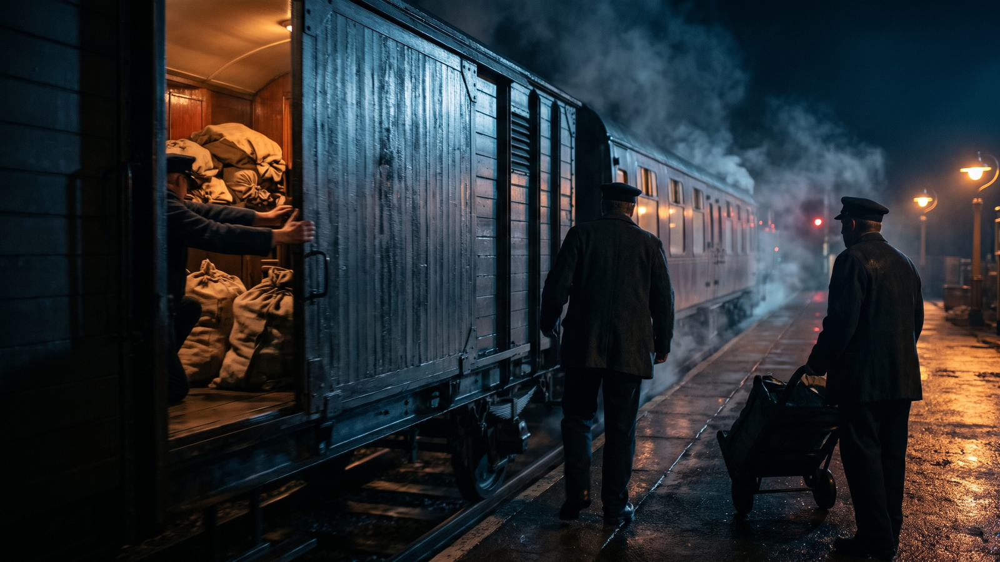

# TeleSync

# TeleSync

Folder sync to Telegram, used as backup storage. A PowerShell script compresses and encrypts a local `sync` folder with 7-Zip, a Python script creates a dated Telegram backup channel, and a Python script uploads the archive to that channel. A batch file repeats the whole cycle every 24 hours.

## Platform

Windows only. The main script is PowerShell, the launcher is a Windows batch file, and the 7-Zip path in the script is a Windows path.

## What each file does

- `main.ps1`: Creates an `encrypted_zips` folder, creates the `sync` folder if it does not exist, and uses 7-Zip to compress and encrypt `sync` into `encrypted_zips/sync.7z` with header encryption (`-mhe=on`). It asks for the archive password at run time. Passwords are not stored in the script. If the archive is larger than 1.9 GB, it asks for a second password (blank reuses the first), re-encrypts the archive into split volumes of at most 1900 MB named `sync.7z.split.001`, `sync.7z.split.002`, and so on, and deletes the unsplit archive.
- `create-channel.py`: Logs in with Telethon and creates a Telegram channel named `backup-YYYYMMDD_HHMMSS` (for example `backup-20230312_132606` is 12 March 2023, 13:26:06). It writes the channel invite link to `channel_invite_link.txt`.
- `upload.py`: Reads the invite link from `channel_invite_link.txt` and runs `telegram-upload` over the files in `encrypted_zips`, with `--large-files=split`, `--print-file-id`, and `preview.png` as the thumbnail file. Run `create-channel.py` first, or the script exits with an explanation.
- `download.py`: Creates a `telegram_downloads` folder, changes into it, and runs `telegram-download --interactive`, so files are picked interactively.
- `24h-run-sync.cmd`: Runs `main.ps1`, `create-channel.py`, and `upload.py`, waits 86400 seconds (24 hours), and loops for as long as the window stays open. It must be run as administrator, and it runs from the folder the batch file itself is in, so the repo can be cloned anywhere.

## Requirements

- Windows, with PowerShell and Python 3
- 7-Zip installed at `C:\Program Files\7-Zip\7z.exe` (https://7-zip.org/download.html). `main.ps1` stops with a message if it is not there.
- Python packages: `pip install -r requirements.txt` (Telethon, and telegram-upload, which provides both the `telegram-upload` and `telegram-download` commands)
- A Telegram API id and hash from https://my.telegram.org/apps

## Setup and first run

1. Clone this repo anywhere, for example on the C drive.
2. Install 7-Zip and the Python packages above.
3. Set the Telegram credentials as environment variables before running `create-channel.py`: `TELEGRAM_API_ID`, `TELEGRAM_API_HASH`, and optionally `TELEGRAM_PHONE`. Without the first two, the script exits with a message saying to set them.
4. Put the files you want backed up in the `sync` folder (the scripts create it empty on the first run if it is missing).
5. Run `24h-run-sync.cmd` as administrator. Each cycle asks for the archive password, and for a second split password if the archive is over 1.9 GB.

## Downloading and opening a backup

Run `python download.py` in the repo folder (the old README said `download.ps1`; the file is a Python script). Opening an archive is done with 7-Zip: extract `sync.7z` directly, or open `sync.7z.split.001` with all split volumes in the same folder, and enter the password or passwords you set when it was created. There is no separate decrypt script in this repo.

## Warnings and limits

- Back up your passwords somewhere safe and private, and not on Telegram. If you lose a password, the archive made with it cannot be opened, and nobody can recover it for you.
- Two different passwords on one backup only happen when the archive is large enough to split: one password for the archive, and a second one for the split volumes.
- Telegram limits how many channels an account can be in or own (the original notes said 500 for free accounts and 1000 for premium). Each sync cycle creates a new channel, so old backup channels add up.
- TSA in the upload preview stands for TeleSync Archive.

## Resources

- 7-Zip: https://7-zip.org/download.html
- telegram-upload: https://github.com/Nekmo/telegram-upload
- Telegram API credentials: https://my.telegram.org/apps
- Telethon docs: https://docs.telethon.dev/en/stable/
- Python: https://www.python.org/

> **Register entry:** Run create-channel.py before upload.py. A lost archive password cannot be recovered, and the split threshold is 1.9 GB with volumes of at most 1900 MB.
